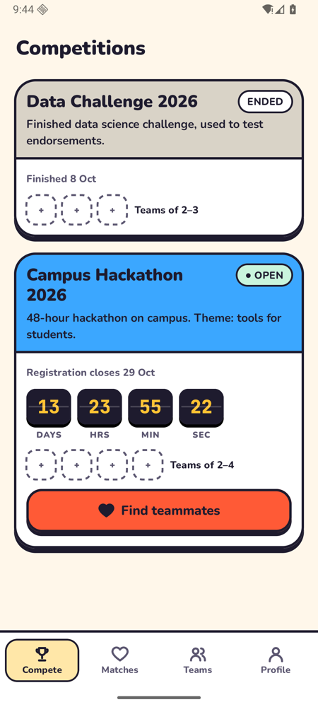
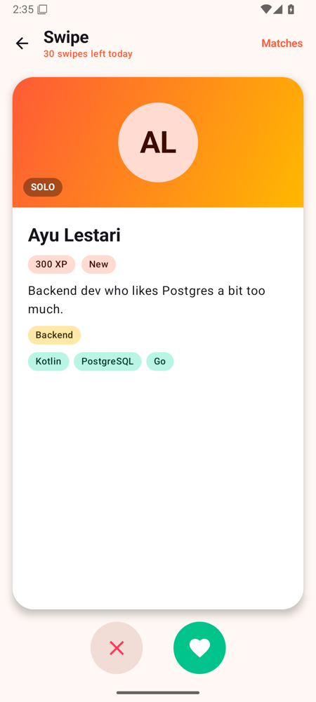
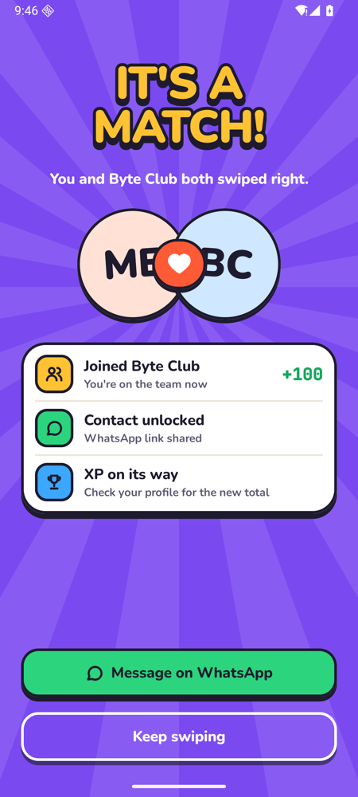
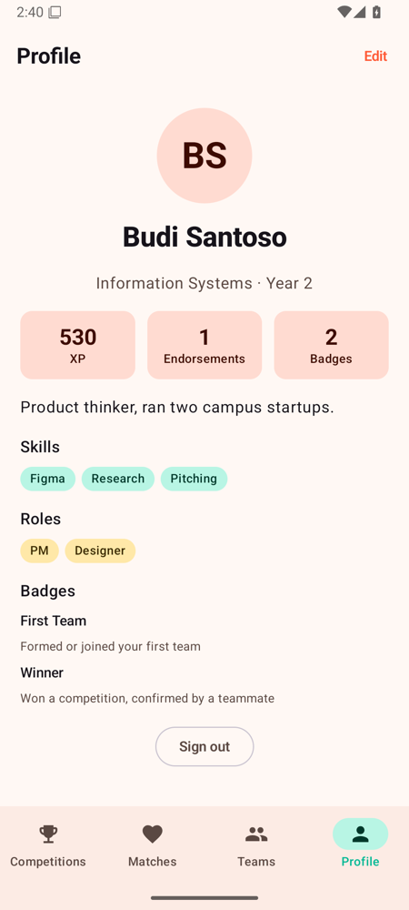
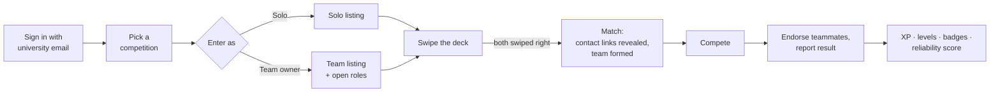
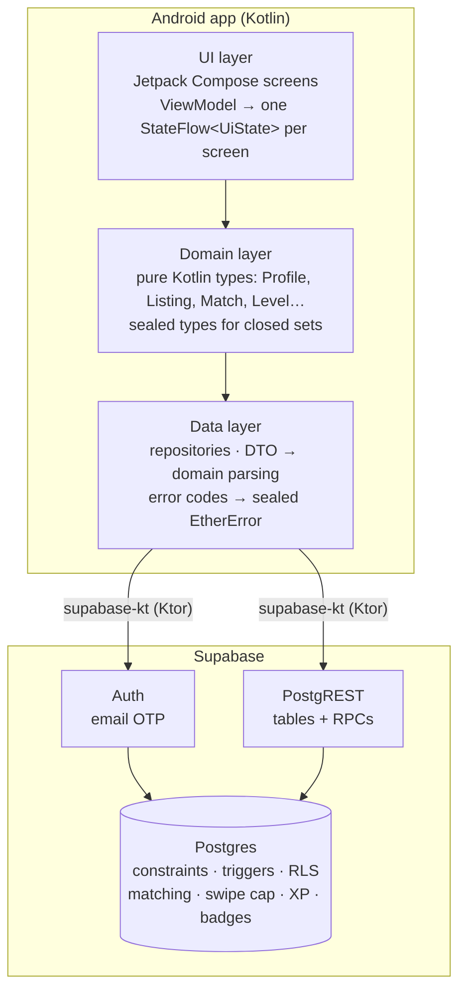
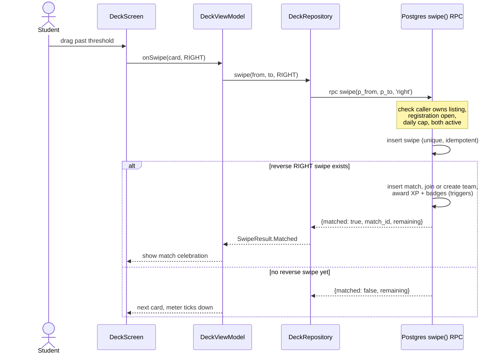

<div align="center">

# ether

**Swipe to find your hackathon team.**

A campus-only Android app where students swipe right on teammates or teams for a specific competition. A mutual right swipe is a match, and a match forms the team.


<table>
  <tr>
    <td></td>
    <td></td>
    <td></td>
    <td></td>
  </tr>
  <tr align="center">
    <td>Pick a competition</td>
    <td>Swipe the deck</td>
    <td>It's a match</td>
    <td>Level up</td>
  </tr>
</table>

[Screen recording](docs/demo/ether-demo.mp4) · [All screenshots](docs/demo) · [Spec](SPEC.md)

</div>

---

## Why

Team finding for campus competitions runs on WhatsApp group posts like "anyone need a designer?". Those posts are noisy and one-sided, and they say nothing about whether a stranger will show up. Students outside a friend circle get left out.

Ether gives each competition its own deck, so everyone you see shares your deadline and goal. Both sides have to say yes, so nobody gets cold-pitched. After the event, teammates endorse each other, which builds a reputation that shows on your card next time.

## Features

- **University-only sign-in.** Email one-time code, limited to the campus email domain.
- **A deck for each competition.** You can enter one as a solo student, or create a team with open roles.
- **Tinder-style swiping.** Drag with tilt and LIKE/NOPE stamps, plus buttons for accessibility.
- **Mutual matches form teams automatically.** The match reveals the WhatsApp or Telegram link.
- **Outcome-based gamification.** You earn XP for forming teams, finishing events, receiving endorsements and confirmed results, not for swiping. You also get 8 levels, from Rookie to Legend, plus badges and a reliability score.
- **Daily cap of 30 swipes,** so swipes stay deliberate.
- **Arcade UI.** Outlined cards with solid offset shadows, springy press feedback, confetti on a match, an XP bar that counts up, haptics, a dark theme, and a reduced-motion mode.

## How it works



The core idea is the **listing**: one solo student, or one team, looking for people within one competition. Swipes and matches happen between listings, so solo and team cards share one code path.

| You → them | Solo | Team |
|---|---|---|
| **Solo** | ✅ Match → the two form a new team | ✅ Match → the solo joins the team |
| **Team** | ✅ Match → the solo joins the team | ❌ Team merging is out of scope |

Only a team's owner swipes for the team. A listing goes inactive when the team is full or the solo joins a team. Registration closes at the competition's deadline.

## Architecture



**Business rules live in Postgres, not the app.** Matching, the swipe cap, XP, badges and who can see whose contact link are enforced by constraints, triggers and row-level security. Because of that, the rules hold for any client, and the app can't grant itself points. The Android app is a thin, well-typed view over them:

- The **data layer** is the only code that sees JSON. It parses rows into domain types and maps database error codes (`swipe_cap_reached`, `registration_closed`, `already_in_team`, …) to a sealed `EtherError` with user-facing messages.
- The **UI layer** gets one `StateFlow<UiState>` per screen. Composables stay mostly stateless.
- **Levels** are display-only and derived from XP on the client (`domain/Level.kt`). XP itself stays in the database.

### A swipe, end to end



The app keeps at most one swipe in flight, and it drops a button tap that races a drag. A retry hits the unique constraint and returns the existing row instead of creating a duplicate swipe.

### Data model

```
Profile      id = auth.uid, name, major, year, bio, skills[], roles[], xp
Competition  name, registration_deadline, event_end, min/max team size
Team         competition, owner, name, pitch, open_roles[]
TeamMember   team, profile            unique(profile, competition)
Listing      competition, kind SOLO|TEAM, profile? | team?, active
Swipe        from_listing → to_listing, LEFT|RIGHT     unique pair
Match        listing_a, listing_b                       unique unordered pair
Endorsement  from → to, competition, positive
Badge / ProfileBadge / XpEvent / TeamResult
```

Contact links live in a separate `profile_contacts` table. Row-level security lets you read one only if you share a match or a team with that person.

### Gamification

| Trigger | XP | Badge |
|---|---|---|
| Profile completed | 50 | |
| First match | 25 | |
| Team formed or joined | 100 | First Team |
| Competition finished | 150 | 3 Hackathons (at 3) |
| Positive endorsement received | 30 | Reliable (at 5) |
| Result reported and confirmed by a teammate | 200 | Finalist / Winner |

Levels: Rookie 0 · Hacker 100 · Maker 250 · Builder 400 · Captain 600 · Architect 850 · Mentor 1150 · Legend 1500.

## Tech stack

| Area | Choice |
|---|---|
| Language / UI | Kotlin 2.4, Jetpack Compose (BOM 2026.09), Material 3 with a custom Arcade theme |
| Navigation / DI / images | Navigation Compose, Koin 4, Coil 3 |
| Backend client | supabase-kt 3.8 (Auth, Postgrest) on Ktor OkHttp |
| Backend | Supabase: Postgres 17, Auth (email OTP), PostgREST, RLS, `SECURITY DEFINER` RPCs |
| Build | AGP 9.4, Gradle 9.8, compileSdk 37, targetSdk 36, minSdk 26 |
| Fonts | Nunito (words) and JetBrains Mono (numbers), bundled offline |
| Tests | JUnit, pgTAP (79 database tests), Maestro (5 end-to-end flows against the real backend) |

## Project layout

```
app/src/main/java/dev/ether/app/
├── domain/        Pure Kotlin model: Profile, Listing, Match, Level, sealed types
├── data/          Repository interfaces
│   ├── supabase/  Supabase implementations, DTOs, error mapping
│   └── fake/      In-memory backend for unit tests and offline demos
├── di/            Koin module
└── ui/            Compose screens + ViewModels
    ├── signin/  competitions/  deck/  matches/  teams/  profile/
    ├── components/   Arcade design system: ledge cards, buttons, meters, badges, confetti
    └── theme/        Colors, type, shapes, motion tokens

supabase/
├── migrations/    schema → logic (RPCs, triggers) → RLS → create_team
├── tests/         pgTAP suite
└── seed.sql       Demo competitions, accounts and teams

.maestro/          End-to-end flows (OTP read from Mailpit)
scripts/           demo.sh, e2e.sh, e2e-setup.sh
docs/              decisions log, design research and mockups, demo screenshots
```

## Download

Get the latest APK from **[Releases](https://github.com/talax0n/Ether/releases/latest)** and open it on an Android 8.0+ phone. Allow installs from your browser or file manager when asked.

Release builds run in **demo mode** on built-in sample data: sign in with any email and the code `123456`. To point releases at a hosted Supabase instead, add the `SUPABASE_URL`, `SUPABASE_ANON_KEY` and `ALLOWED_EMAIL_DOMAIN` repo secrets.

**Publishing a release:** push a tag (`git tag v0.2.0 && git push origin v0.2.0`), or run the *Release APK* workflow from the Actions tab. [`release.yml`](.github/workflows/release.yml) runs the unit tests, builds an APK signed with the release key (stored in repo secrets), and attaches it to a GitHub Release.

## Getting started

**Requirements:** macOS or Linux, Docker, the [Supabase CLI](https://supabase.com/docs/guides/cli), JDK 17, and the Android SDK (platform 36 and an emulator image).

### One-command demo

```sh
scripts/demo.sh
```

This starts local Supabase and resets it to the seed data, then writes `local.properties` if it is missing. Next it boots the `ether` emulator, creating it if needed, and installs and opens the app. It is safe to re-run. Use `HEADLESS=1` to run without a window.

Sign in with `demo1@student.example.ac.id` … `demo8@student.example.ac.id`, or any new `@student.example.ac.id` address. The 6-digit code arrives in Mailpit at **http://127.0.0.1:54324**.

| Try this | Account |
|---|---|
| Instant match: Byte Club has already liked you, so swipe right on it | `demo3` (after `scripts/e2e-setup.sh`) |
| Endorse teammates and report a result for an ended event | `demo1` |
| A fresh account from profile setup onward | any new address |

### Run on a phone over USB

`10.0.2.2` only reaches the host from the emulator. On a real phone, tunnel through USB instead:

```sh
# in local.properties: SUPABASE_URL=http://localhost:54321
adb reverse tcp:54321 tcp:54321
./gradlew :app:installDebug
```

### Configuration

Set these in the gitignored `local.properties` or as environment variables:

```properties
SUPABASE_URL=http://10.0.2.2:54321   # local Supabase as seen from the emulator
SUPABASE_ANON_KEY=...                 # from `supabase status`; blank → in-memory demo backend
USE_FAKE_BACKEND=false                # true → offline demo (any email, code 123456)
ALLOWED_EMAIL_DOMAIN=student.example.ac.id
```

The allowed domain is enforced in the database (`app_config.allowed_email_domain`). The app only uses `ALLOWED_EMAIL_DOMAIN` to word the error message.

## Testing

```sh
./gradlew :app:testDebugUnitTest   # unit tests: ViewModels, levels, PostgREST JSON contract
supabase test db                   # pgTAP: matching, races, swipe cap, RLS, XP, badges
scripts/e2e.sh                     # Maestro on the emulator against real local Supabase
```

The end-to-end suite covers these flows:
- sign-up and onboarding
- rejecting an email from outside the university
- swiping into a match
- creating a team and seeing it in another user's deck
- endorsing a teammate and confirming a result, with the XP and badge updates

It resets the database first, and it refuses to run against a non-local backend or a physical device.

## Security

- The app ships only the Supabase anon key, which is public by design. Access control is row-level security on every table.
- The service-role key never goes in the app or the repo. Real config stays in gitignored `local.properties` and `.env`.
- RPCs that change data run as `SECURITY DEFINER` with a pinned `search_path`, and they check the caller with `auth.uid()`.
- Release builds are HTTPS-only. Debug builds allow cleartext only to `10.0.2.2` and `localhost`.

## Docs

- [SPEC.md](SPEC.md): problem, scope, domain model, gamification, non-goals, risks
- [PLAN.md](PLAN.md): build order and definition of done
- [docs/decisions.md](docs/decisions.md): decision log with the reasoning behind each choice
- [docs/design](docs/design): UI research and three animated design directions (Arcade was picked)
- [docs/demo](docs/demo): screenshot walkthrough and screen recording
- [supabase/CONTRACT.md](supabase/CONTRACT.md): the RPC and table contract between the app and the database

## Roadmap

These are not in the MVP. See SPEC §7 for the reasons.

- Push notifications for new matches (first post-MVP item)
- Deploy to hosted Supabase with the real university domain
- Signed release build and a Play Store internal track
- Leaderboards, once there are enough users for rankings to mean something

## License

MIT. See [LICENSE](LICENSE).
